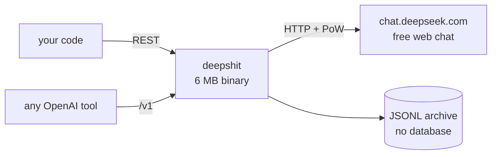
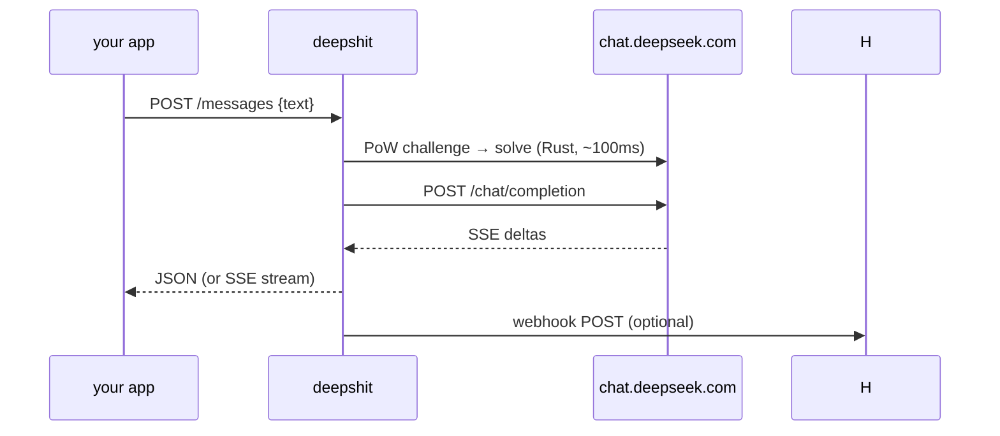

<div align="center">
<pre>
██████╗ ███████╗███████╗██████╗ ███████╗██╗  ██╗██╗████████╗
██╔══██╗██╔════╝██╔════╝██╔══██╗██╔════╝██║  ██║██║╚══██╔══╝
██║  ██║█████╗  █████╗  ██████╔╝███████╗███████║██║   ██║   
██║  ██║██╔══╝  ██╔══╝  ██╔═══╝ ╚════██║██╔══██║██║   ██║   
██████╔╝███████╗███████╗██║     ███████║██║  ██║██║   ██║   
╚═════╝ ╚══════╝╚══════╝╚═╝     ╚══════╝╚═╝  ╚═╝╚═╝   ╚═╝   
</pre>

<h3>Your free DeepSeek web account, as an API.</h3>

One Rust binary. No Docker. No database. No API bill.

[](https://www.rust-lang.org)
[](https://github.com/aniceswan/deepshit)
[](https://github.com/aniceswan/deepshit)
[](https://github.com/aniceswan/deepshit)
[](https://github.com/aniceswan/deepshit)
[](LICENSE)

[⚡ Quick start](#-quick-start-5-minutes) •
[🤖 OpenAI mode](#-use-it-like-openai) •
[📚 API](#-api-reference) •
[🚀 Deploy](#-run-it-on-a-server) •
[🆘 Help](#-when-something-breaks)

</div>

---

## What is this?

DeepSeek's official API costs money. Its **web chat is free**.
`deepshit` sits in the middle and speaks both sides:



Login once with a token from your own browser. Everything after that
is plain HTTP: chat, threads, streaming, stop, DeepThink, web search,
file upload — plus a drop-in OpenAI endpoint your existing tools
already understand.

---

## ⚡ Quick start (5 minutes)

You need: **Rust stable** + **a free DeepSeek account**. Two terminals.

### 1/3 — Build & run

```bash
git clone https://github.com/aniceswan/deepshit
cd deepshit
cargo build -p ds-gateway
./target/debug/deepshit
```

```
listen 127.0.0.1:3000 (archive: file, auth: off (dev))
DeepSeek web ready: login via POST /sessions/login, then send.
```

> Leave it running. Everything below goes in the **second** terminal.

### 2/3 — Copy one token from your browser (one time only)

| # | Do this | Where |
|---|---------|-------|
| 1 | Open `chat.deepseek.com`, login normally | browser |
| 2 | Press `F12` → **Application** → **Local Storage** → `https://chat.deepseek.com` | devtools |
| 3 | Click `userToken`, right-click its `value` → Copy value | devtools |

No password involved. No password stored. Ever.

### 3/3 — Register it, say hello

```bash
curl -X POST localhost:3000/sessions/login \
  -H 'content-type: application/json' \
  -d '{"id":"utama","token":"PASTE_TOKEN_HERE"}'
# {"id":"utama","logged_in":true}

CHAT=$(curl -s -X POST localhost:3000/sessions/utama/chats \
  | python3 -c "import json,sys; print(json.load(sys.stdin)['chat_id'])")

curl -X POST localhost:3000/sessions/utama/chats/$CHAT/messages \
  -H 'content-type: application/json' \
  -d '{"text":"hello, who are you?"}'
```

```json
{"text": "I am DeepSeek, ...", "conversation_id": "<chat>:2"}
```

🎉 Done. The token lives in `./ds-data/` — restarts skip step 2 forever.

<details>
<summary>No Rust? No second terminal? One-command demo (touches nothing)</summary>

```bash
bash scripts/local-up.sh   # build + isolated server + smoke test
```

</details>

---

## ✨ Features

```
 ✓  chat, threads, history, delete, rename (syncs to the web)
 ✓  streaming (native SSE + OpenAI SSE, ends with data: [DONE])
 ✓  stop a running generation mid-way (proven: 8 KB vs 48 KB)
 ✓  DeepThink reasoning (split field, never mixed into the answer)
 ✓  web search with [citation:n] references
 ✓  file upload + ask about the file (auto-waits for indexing)
 ✓  OpenAI-compatible /v1 (SDKs, agents, LibreChat, …)
 ✓  multi-account, per-account locks, rate limiting, webhook, CORS
 ✓  file archive, zero database, systemd-ready, ~6 MB binary
```

---

## 🤖 Use it like OpenAI

Change only the `base_url`. Any key works. Pick the DeepSeek account
with the `x-session-id` header (default `utama`).

<table>
<tr><td>

**Python**

```python
from openai import OpenAI

client = OpenAI(
    base_url="http://localhost:3000/v1",
    api_key="anything",
)
r = client.chat.completions.create(
    model="deepseek-chat",  # or "deepseek-reasoner"
    messages=[{"role": "user", "content": "hello"}],
    extra_headers={"x-session-id": "utama"},
)
print(r.choices[0].message.content)

# keep talking:
# extra_body={"conversation_id": r.conversation_id}
# think + search:
# extra_body={"thinking": True, "search": True}
```

</td><td>

**Node.js**

```js
import OpenAI from "openai";
const client = new OpenAI({
  baseURL: "http://localhost:3000/v1",
  apiKey: "anything",
});
const r = await client.chat.completions.create(
  { model: "deepseek-chat",
    messages: [{ role: "user", content: "hello" }] },
  { headers: { "x-session-id": "utama" } },
);
console.log(r.choices[0].message.content);
```

</td></tr>
</table>

```bash
# streaming with plain curl
curl -N -X POST localhost:3000/v1/chat/completions \
  -H 'content-type: application/json' \
  -d '{"model":"deepseek-chat",
       "messages":[{"role":"user","content":"hello"}],
       "stream":true}'
# data: {"choices":[{"delta":{"role":"assistant",...},...}],...}
# ...
# data: [DONE]
```

Thinking returns as `reasoning_content`, separate from the answer.
CORS is open, so browser apps work directly.

---

## 🎬 Real session (copied from a live run)

```bash
$ curl -X POST .../chats/$CHAT/messages -d '{"text":"1+1=? exactly"}'
{"text":"2","conversation_id":"c7dbe8f6:2"}

$ curl -X POST .../messages/with-files \
    -F text="name the animal, food and code in the file" \
    -F file=@secret.txt
{"text":"Fiction animal: blue-striped quokka. Food: caramel mint leaves. Code: ZXQ-7741."}

$ curl -X POST .../messages -d '{"text":"capital of france? short","thinking":true}'
{"text":"Paris","thinking":"We need answer in Indonesian..."}
```

How a request flows:



---

## 📚 API reference

Base `http://127.0.0.1:3000`. Everything needs login except `/health`.

```
GET  /health                                     → {"ok":true,...}

POST /sessions/login            {"id","token"}   → {"logged_in":true}
GET  /sessions                                   → ["utama",...]
GET  /sessions/:id/status
POST /sessions/:id/refresh
DELETE /sessions/:id                             logout + forget

POST /sessions/:id/chats                         → {"chat_id"}
GET  /sessions/:id/chats                         → {"chats":[{"id","title"}]}
GET  /sessions/:id/chats/:cid/messages           history
POST /sessions/:id/chats/:cid/messages           send
POST /sessions/:id/chats/:cid/messages/stream    stream (SSE)
POST /sessions/:id/chats/:cid/messages/with-files  send + file (multipart)
POST /sessions/:id/chats/:cid/stop               stop
POST /sessions/:id/chats/:cid/rename             {"title"} (syncs to web)
DELETE /sessions/:id/chats/:cid                  delete
POST /sessions/:id/upload                        file only (multipart)
GET  /sessions/:id/messages                      local archive (last 50)

GET  /v1/models
POST /v1/chat/completions                        OpenAI-compatible
```

Send body: `{"text","thinking?","search?","model?","conversation_id?"}`
— pass `conversation_id` (`"<chat>:<msg>"`) to continue a thread.

---

## 🧠 Good to know

Found by reverse-engineering the web app, all verified live:

```
┌─────────────┬────────────────────────────────────────────────┐
│ thinking    │ answer splits into text + thinking             │
│ search      │ answers carry [citation:n] references          │
│ upload      │ server indexes files ~3 min; gateway waits     │
│ rename      │ syncs to the web; empty chats can't be renamed │
│             │ by the server — send 1 message first           │
│ search+file │ rejected by the server, don't combine          │
│ usage       │ estimated ~4 chars/token (web gives no counts) │
│ models      │ deepseek-chat (fast) / deepseek-reasoner       │
│             │ (+ aliases: r1, v3, …)                          │
└─────────────┴────────────────────────────────────────────────┘
```

Not logged in? You get `409` with instructions, never silence.

---

## ⚙️ Settings & storage

```bash
deepshit run --help
```

| Flag | Env | Default | What |
|------|-----|---------|------|
| `--data-dir` | `DATA_DIR` | `./ds-data` | logins + titles + chat archive |
| `--media-dir` | `MEDIA_DIR` | `./ds-media` | uploads (hashed, per session) |
| `--listen` | `LISTEN` | `127.0.0.1:3000` | where the API listens |
| `--session-id` | `SESSION_ID` | `utama` | auto session (`""` = off) |
| `--api-token` | `API_TOKEN` | _empty_ | ⚠️ **set this in production** (Bearer, everything but `/health`) |
| `--webhook-url` | `WEBHOOK_URL` | _empty_ | POST JSON here per finished reply |
| `--rate-limit-per-minute` | `RATE_LIMIT_PER_MINUTE` | `30` | `/v1` limit per IP |

```
deepshit                 setup + run (the default)
deepshit setup --auto    prepare folders (safe to repeat)
deepshit run             serve (no setup)
deepshit reset --yes     wipe archive + media (+ --with-session forgets logins)
```

Idle for weeks? Fine: stateless HTTP per request, token watchdog every
5 minutes, systemd restarts on crash. If the token itself dies (`401`),
register a fresh one — 30 seconds.

---

## 🚀 Run it on a server

```bash
cargo build --release -p ds-gateway   # → ./target/release/deepshit (~6 MB)
sudo bash deploy/install.sh ./target/release/deepshit
curl http://127.0.0.1:3000/health
sudo systemctl status deepshit
```

Why `sudo`? Install writes to `/usr/local/bin`, creates the `ds` user
and data dirs, and enables the systemd service (boot auto-start +
crash restart). Pass `API_TOKEN=...` to lock the API at install time.

---

## 🆘 When something breaks

| Symptom | Meaning | Fix |
|---------|---------|-----|
| `409` / not logged in | no session yet | quick start, step 3 |
| token rejected (`401`) | token died | fresh token (step 2) |
| `EMPTY_CHAT_SESSION` on rename | server rule | send 1 message first |
| `429` | rate limit | wait for `Retry-After` |
| `502` | DeepSeek/WAF hiccup | retry in a bit |
| port in use | — | `--listen 127.0.0.1:3105` |

---

## 🛠️ For developers

```bash
cargo test                # 19 unit tests (PoW, SSE parser, OpenAI format, archive)
bash scripts/local-up.sh  # isolated end-to-end smoke test
```

```
┌─ crates/ds-core ───── pure-Rust DeepSeekHashV1 PoW + SSE parser + types
├─ crates/ds-auth ───── per-account token session (file, refresh, watchdog)
├─ crates/ds-chat ───── chat client: send/stream/stop/upload/rename/history
├─ crates/ds-store ───── JSONL archive per session (no database)
├─ crates/ds-gateway ─── the deepshit binary (REST + OpenAI + webhook)
└─ deepseek-protocol.md   raw reverse-engineering notes (endpoints, PoW, curl)
```

The interesting bits live in `ds-core/src/pow.rs` (custom Keccak rounds
1..23 — standard SHA3 libraries give the wrong hash) and
`ds-core/src/sse.rs` (the stream mixes `THINK`/`RESPONSE` fragments and
reorders the final answer into an `APPEND` array).

---

## ⚖️ Fine print

Unofficial. Not affiliated with DeepSeek. Made for calm personal use —
respect DeepSeek's ToS, no spam, no hammering. MIT licensed, use at
your own risk.
